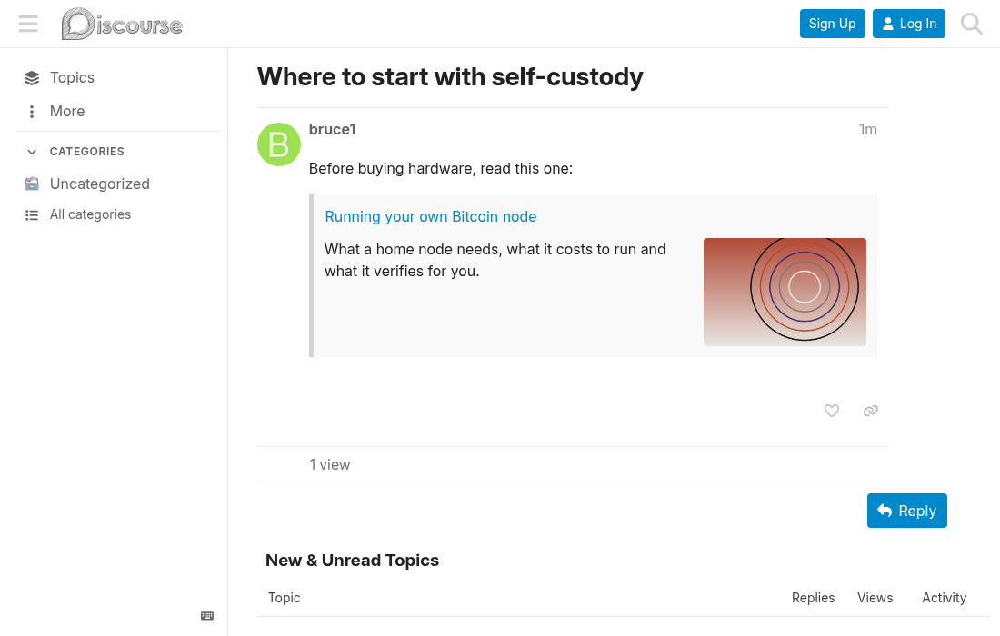

# Local onebox

[ENGLISH](README.md) | **ESPAÑOL**

Mantenido por Criptonautas. Sin afiliación ni respaldo de Discourse (Civilized Discourse Construction Kit, Inc.).

Componente de tema para Discourse. Un enlace a otro topic del mismo foro se muestra como un
recuadro con el comienzo del primer post y sin imagen. Este componente reemplaza ese texto por
el gist de [Discourse AI](https://meta.discourse.org/t/discourse-ai/259214) del topic, o por su
extracto de la lista cuando no hay gist, y agrega la portada del topic.

## Instalación

Admin → Personalizar → Temas → Componentes → Instalar → Desde un repositorio git, con la URL de este repo.

## Notas

Todos los recuadros de una página se resuelven con un solo pedido a la lista de topics del
propio foro, y cada topic se pide una vez por visita. Si ese pedido falla, los recuadros quedan
como estaban.

Los gists se muestran solo a los grupos permitidos en los ajustes de gists de Discourse AI. El
resto ve el extracto.

Funciona solo en el foro. Los mails y el RSS conservan el recuadro original.

Solo cambian los enlaces al primer post de un topic. Los enlaces a una respuesta y las citas
reales quedan como están. El botón para expandir el recuadro se oculta: expandirlo traería de
vuelta el texto original.

Los topics de una categoría que el visitante silenció no vuelven en la lista de topics, así que
sus recuadros quedan como los muestra el núcleo.

### Efectos de instalarlo

- `serialize_topic_excerpts` agrega el extracto a cada lista de topics que sirve este tema.
- `topic_thumbnail_sizes` hace que Discourse genere un tamaño de 400px para los topics
  existentes, en segundo plano.

Requiere Discourse 2026.1.0 o posterior.

## Licencia

MIT. Ver [LICENSE](LICENSE).

Texto de este README bajo [CC BY-NC-SA 4.0](CC-BY-NC-SA-4.0.txt).
