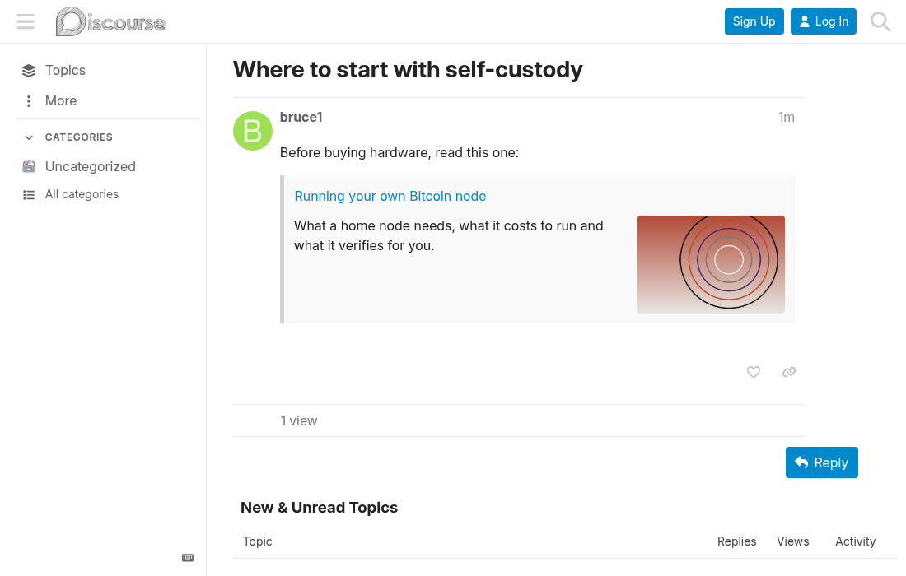

# Local onebox

**ENGLISH** | [ESPAÑOL](README.es.md)

Maintained by Criptonautas. Not affiliated with or endorsed by Discourse (Civilized Discourse Construction Kit, Inc.).

Discourse theme component. A link to another topic of the same forum renders as a box with
the start of its first post and no image. This component replaces that text with the topic's
[Discourse AI](https://meta.discourse.org/t/discourse-ai/259214) gist, or its list excerpt
when there is no gist, and adds the topic's cover.

## Install

Admin → Customize → Themes → Components → Install → From a git repository, with this repo's URL.

## Notes

All the boxes on a page are resolved with a single request to the forum's own topic list,
and each topic is asked for once per visit. If that request fails, the boxes stay as they were.

Gists show only to the groups allowed in Discourse AI's gist settings. Everyone else gets the
excerpt.

It works in the forum only. Emails and RSS keep the original box.

Only links to a topic's first post change. Links to a single reply and real quotes stay as
they are. The box's expand toggle is hidden: expanding would bring back the original text.

Topics in a category the viewer muted don't come back from the topic list, so their boxes stay
as core renders them.

### Side effects of installing it

- `serialize_topic_excerpts` adds the excerpt to every topic list served with this theme.
- `topic_thumbnail_sizes` makes Discourse generate a 400px size for existing topics, in the
  background.

Requires Discourse 2026.1.0 or later.

## License

MIT. See [LICENSE](LICENSE).

Text of this README under [CC BY-NC-SA 4.0](CC-BY-NC-SA-4.0.txt).
